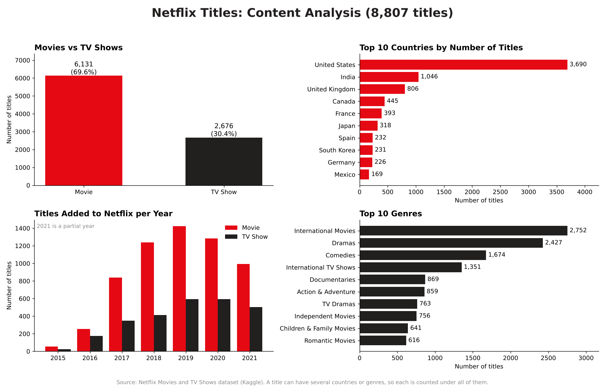

# Netflix Data Visualization

Visual analysis of 8,807 Netflix movies and TV shows, answering four questions about the catalog.

## Key findings
- Movies make up 69.6% of the catalog (6,131 titles) and TV Shows 30.4% (2,676).
- The United States has the most titles (3,690), followed by India (1,046) and the United Kingdom (806).
- Titles added per year grew sharply from 2016 and peaked in 2019. 2021 is a partial year.
- International Movies (2,752), Dramas (2,427), and Comedies (1,674) are the most common genres.

## Notes
- A title can list several countries or genres, so each one is counted under all of them.
- 831 titles have no country listed and were left out of the country chart.

## Tools used
Python (pandas, matplotlib), data analysis, data visualization

## Dataset
Netflix Movies and TV Shows (Kaggle)
